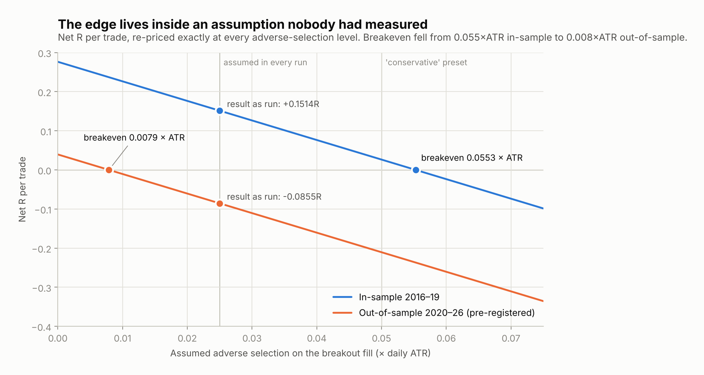
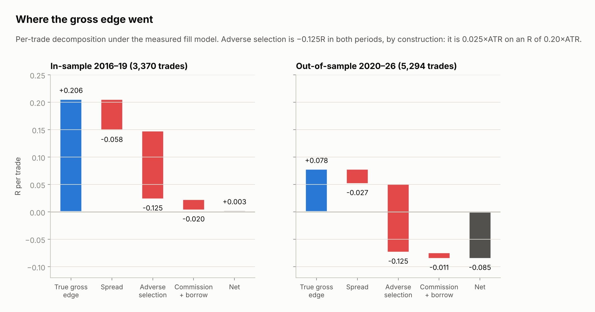
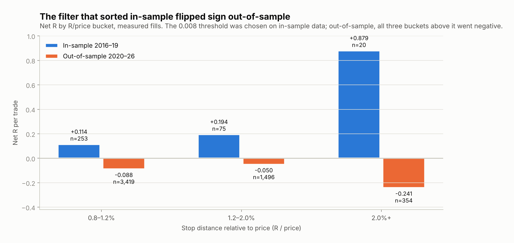
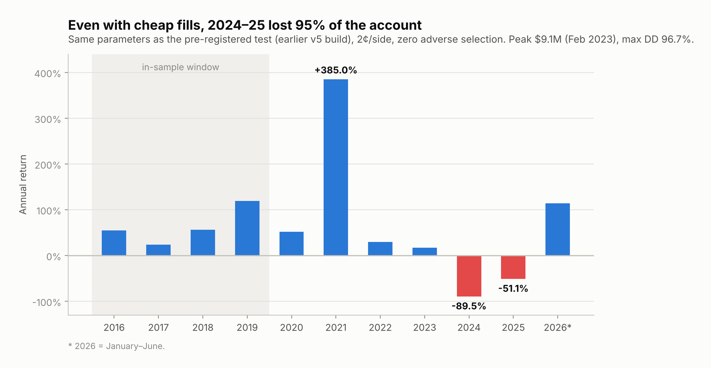

# Pricing the fill: a pre-registered out-of-sample test of a 1,637% day-trading strategy

**[David Sun]** · [Cornell University] · August 2026

A 2024 paper reports that a 5-minute opening-range breakout on high relative-volume US stocks
returned **1,637% from 2016 to 2023, Sharpe 2.81**, modelling commissions but no slippage. I rebuilt
it on QuantConnect, found a defect in my own cost accounting, showed that the cost of getting
filled is a fixed fraction of every trade's risk by construction, then froze the best in-sample
configuration, wrote my predictions and a kill rule into the code, and ran 2020–2026 once.

**It lost −0.0855R per trade (t = −2.16) and the strategy was killed by the rule written before
the run.**



### Key findings

1. **A labelling defect hid the real cost.** My "gross" P&L was computed from fill prices, which
   already include slippage, so *gross minus net* measured commission, not friction. It understated
   trading cost by a factor of ten.
2. **The real gross edge existed, and fills took 89% of it.** In-sample the breakout earned
   +0.206R per trade before costs. Spread and adverse selection took 0.183R.
3. **Adverse selection is a constant 0.125R per trade, for every stock and every year.** With risk
   unit R = 0.20 × ATR and a fill cost of 0.025 × ATR, the ratio does not depend on the name, price,
   volatility or period, so no stock filter or ranking can escape it.
4. **Out-of-sample, breakeven needs nearly free fills.** The in-sample config broke even at
   0.055 × ATR of adverse selection. Out-of-sample it needs 0.008 × ATR.
5. **The signal itself also broke.** With free fills (2¢/side, no adverse selection) the same
   configuration lost **89.5% in 2024 and 51.1% in 2025**.
6. **I scored my own predictions: 4 of 12 right.** Every economically meaningful prediction fell
   outside its 80% interval. The scorecard is below, unedited.

### Contents

[The claim](#1-the-claim) · [Setup](#2-setup) · [The accounting defect](#3-the-accounting-defect) ·
[Why no filter can escape the cost](#4-why-no-filter-can-escape-the-cost) · [Result](#5-result) ·
[Cross-checks](#6-cross-checks) · [What I got wrong](#7-what-i-got-wrong) ·
[Other replications](#8-how-this-compares-with-other-replications) · [Limitations](#9-limitations) ·
[Reproduce](#10-reproduce)

---

## 1. The claim

Zarattini, Barbon & Aziz (2024), *A Profitable Day Trading Strategy For The U.S. Equity Market*,
Swiss Finance Institute Research Paper 24-98 ([SSRN](https://papers.ssrn.com/sol3/papers.cfm?abstract_id=4729284)).

- **Rule.** Each morning, rank stocks by opening 5-minute volume relative to their 14-day average
  ("Stocks in Play"). Take the top 20. If the first 5-minute candle is green, place a buy-stop at its
  high; if red, a sell-stop at its low. Stop loss at 10% of daily ATR. Exit at the close.
- **Reported result (2016–2023, 7,000+ stocks):** 1,637% total, 41.6% a year, Sharpe 2.81,
  alpha 35.8%, beta 0.00. The same breakout *without* the relative-volume filter: 29% total, Sharpe 0.48.
- **Costs:** $0.0035/share commission. The paper states no slippage assumption.

The question I set out to answer: **is that return available to someone who actually has to get
filled?**

## 2. Setup

QuantConnect LEAN, Python, minute bars.

| | Paper | This study |
|---|---|---|
| Universe | 7,000+ stocks (CRSP) | 500 most liquid by dollar volume, **point-in-time** (delisted names included and verified in the trade log) |
| Selection | Top 20 by relative volume | Top 5 by relative volume, ATR ≥ $3, ATR/price ≥ 4% |
| Entry | Stop order at the opening-range extreme | Same |
| Exit | 0.10 × ATR stop, or close | Close only (under realistic fills, every stop width tested did worse than no stop) |
| Sizing | 1% risk, 4× leverage cap | 3.6× gross target (pattern-day-trader margin), flat 12 min before close |
| Costs | Commission only | Commission, 1.5 bp half-spread, **adverse selection 0.025 × ATR on entry**, 3%/yr short borrow |

**The signal is real.** Reversing the entry direction (sell the green breakout, buy the red) turned
an in-sample Sharpe of +0.94 into −0.88 (earlier build, 2¢ fills; probabilistic Sharpe 0.001%). The breakout direction
carries information. The question is entirely whether it pays for its own execution.

**Units.** R is a fixed risk unit of 0.20 × daily ATR per share. Net R per trade is independent of
position size, so it is comparable across runs where CAGR is not.

## 3. The accounting defect

Every log before the final build printed a line like `mean gross +0.0228R   NET +0.0025R`, and I
read the difference as the cost of trading: about 0.02R. The code:

```python
gross_r = ((exit_price - sd.entry_price) * sd.direction) / sd.r_dollars
```

`entry_price` and `exit_price` are **fill prices**, which already contain the slippage model. So
"gross" was already net of slippage, and gross minus net was only commission and borrow.

Rebuilding the true decomposition from the run's own slippage audit:



| per trade, in R | In-sample 2016–19 | Out-of-sample 2020–26 |
|---|---|---|
| **True gross edge** (decision price to decision price) | **+0.206** | **+0.078** |
| Spread, both sides | −0.058 | −0.027 |
| **Adverse selection, entry** | **−0.125** | **−0.125** |
| Commission + borrow | −0.020 | −0.011 |
| **Net** | **+0.0025** | **−0.0855** |

*In-sample column: the 2016–19 run without the R/price filter (3,370 trades); out-of-sample
column: the pre-registered run. See [`results/`](results/).*

The real cost was 0.203R against the 0.020R I had been reading, ten times larger. **In-sample the
edge-to-cost ratio was about 1.0:** a genuine signal that exactly paid for its own execution.

*Verification.* The reconstructed half-spread (2.59¢/side) matched the log's independently
computed exit slippage exactly, and the reconstructed round trip ($0.1635) matched the model's
logged total ($0.1634) to 0.05%. The out-of-sample run computes this decomposition itself and
checks it against the slippage log ($0.2375 vs $0.2375, `AGREE`).

## 4. Why no filter can escape the cost

A stop order resting at the opening-range extreme sits at the most-watched price of the session.
It fills when someone trades through it, which is exactly when the information has gone against
you. That cost scales with how volatile the stock is, so I modelled it as a fraction of ATR. The
risk unit is also a fraction of ATR:

```
adverse cost in R  =  (0.025 × ATR) / (0.20 × ATR)  =  0.125 R    for every trade
```

ATR cancels. The cost is the same for every stock, price level, volatility regime and year.
**Filtering or ranking changes which trades you take; it cannot change what each one costs.**
That is why every in-sample variant I tried (ranking by relative volume or by volatility spike,
gap filters, profit targets, intraday exits) moved the gross edge around by about ±0.1R while
this charge stayed fixed.

It also makes sensitivity exact rather than simulated. For any assumed adverse selection *a*:

```
net(a)    = net(0.025) + (0.025 − a) / 0.20
breakeven = 0.025 + 0.20 × net(0.025)
```

The 0.025 is an assumption; it was never measured. So instead of reporting one number, the final
version of the code reports the whole curve (Figure 1). The in-sample champion survives up to
0.055 × ATR. Out-of-sample it needs 0.008 × ATR, essentially free liquidity taking.

## 5. Result

### What was frozen

The best in-sample configuration ("Jumping Orange Frog": +0.1514R per trade, 23.5% CAGR, Sharpe
0.60, 1,205 trades, 2016–19), unchanged, on 2020 to June 2026. The predictions, decision rule and
void conditions were written into the code's docstring and printed as the first lines of the run's
log, before any trade was simulated. Full text: [PREREGISTRATION.md](PREREGISTRATION.md).

Decision rule, committed in advance:

| Net R per trade | Verdict |
|---|---|
| ≤ 0 | The in-sample result was selection noise. **Strategy closes.** |
| 0 to +0.05 | Alive but not tradeable; breakeven sits inside the uncertainty of an unmeasured parameter |
| > +0.05 | Replicated; proceed to live fill measurement at minimum size |

One line from the pre-registration, written before the run: *"at n = 2,600, SE = 0.054, so my own
central prediction of +0.09R lands at t = 1.67. If I am exactly right, this run STILL does not
reach significance."*

### What happened

**Net −0.0855R per trade on 5,294 trades (t = −2.16). $100,000 → $141. Strategy closed.**

| # | Prediction | Actual | |
|---|---|---|---|
| 1 | Net R +0.09 [−0.02, +0.20] | **−0.0855** | ✗ |
| 2 | Trades 2,600 [1,800, 3,800] | 5,294 | ✗ |
| 3 | CAGR +8% [0%, +18%] | −63.5% | ✗ |
| 4 | Sharpe 0.33 [0.05, 0.60] | −0.686 | ✗ |
| 5 | Max drawdown 62% [45%, 78%] | 99.9% | ✗ |
| 6 | Breakeven adverse selection 0.043 × ATR [0.021, 0.065] | 0.0079 | ✗ |
| 7 | Worst day below −18%, in Feb–Mar 2020 or Jan–Feb 2021 | −25.1% on 2020-03-19 | ✓ |
| 8 | Integrity check clean, no stranded positions | Clean | ✓ |
| 9 | ~25% chance of a margin event in March 2020 | Margin events in Feb and May 2020 | ✓ |
| 10 | 2020 net R above the full-period figure | −0.039 vs −0.086 | ✓ (weak) |
| 11 | In 2022, shorts outperform longs | Longs +0.120, shorts −0.114 | ✗ |
| 12 | 2023–26 breadth falls below 1 trade/day | 3.35 / 3.35 / 1.86 | ✗ |

All four hits are mechanical or directional. Every prediction about money missed its interval.

**There was no profitable stretch out-of-sample.** 2020–2023: −0.0066R per trade over 3,876 trades
(t = −0.14), indistinguishable from zero. 2024 – June 2026: −0.3010R over 1,418 trades (t = −3.94).

## 6. Cross-checks

**The paper's own specification converges on the same number.** Run out-of-sample with 2¢ fills
and a 1R stop, the original-spec build made +0.0696R per trade and 33.5% a year (Sharpe 0.74).
Re-priced under the same fill model as above, it nets −0.073R, within noise of −0.0855R from a
different code path, filter and exit. A protective stop is itself a resting order, so charging it
the same adverse selection takes it to −0.162R.

**The filter I selected in-sample flipped sign.** The stop-distance-relative-to-price filter
(R/price ≥ 0.8%) sorted cleanly in six consecutive in-sample runs. All three
buckets above the threshold went negative out-of-sample.



**Free fills don't rescue it.** The frozen configuration, 2016 to June 2026, at 2¢/side and zero
adverse selection: peak $9.1M in February 2023, then −89.5% in 2024 and −51.1% in 2025. Max
drawdown 96.7%. Commissions alone ($838,627) exceeded total profit ($712,153).



So two separate things are wrong: the edge never covered realistic execution, and after 2023 it
stopped existing even before execution.

## 7. What I got wrong

- **I optimised mean R per trade, which is the wrong objective for a levered book.** Two
  out-of-sample runs with free fills: the one with the *higher* mean (+0.098R vs +0.070R) ended with
  one sixth the money ($115,645 vs $654,711). Their arithmetic drift was nearly identical (0.331 vs
  0.355 a year); the whole gap was volatility drag at 79% vs 36% annual volatility.
- **The filter I championed caused that volatility.** Requiring ATR/price ≥ 4% concentrated the
  book in names like COIN, SMCI and AMC. I tracked its effect on mean R for weeks and never checked
  its effect on portfolio volatility.
- **A drafting error in the pre-registration.** I listed "leverage-bound below 97%" as a condition
  that voids the whole run. It fired. But with no market-impact term, net R per trade does not
  depend on position size, so it only voids CAGR comparability, not the primary metric. I took the
  reading that closes the strategy; treating the run as void would have been the self-serving one.
- **Mechanism claims made before looking at the data.** Mid-run I diagnosed a concentration problem
  from a screenshot. The finished log showed 14 qualifying names a day and no single stock above
  3.6% of P&L. It was wrong, and so were three earlier explanations of this kind.
- **Eight of twelve predictions**, scored above.

## 8. How this compares with other replications

- **QuantConnect's own replication** covers 2016 only (Sharpe 2.40) and does not state its slippage
  assumption ([post](https://www.quantconnect.com/research/18444/opening-range-breakout-for-stocks-in-play/)).
- **An independent replication of the authors' QQQ version** matches the paper, then breaks even at
  about 2.2¢/share of slippage against a ~1¢ spread ([repo](https://github.com/giovannibrusco/zarattini-2023-orb-qqq)).
- **A walk-forward test of opening-range breakouts on Nasdaq micro futures** (2021–2025) found
  t = 0.88 out-of-sample, short of its 2.0 bar ([arXiv 2605.04004](https://arxiv.org/abs/2605.04004)).
- **A review of the paper** found no independent post-2023 test of the filtered strategy
  ([Tradoki](https://blog.tradoki.com/posts/opening-range-breakout-stocks-in-play-research)).

This study adds a point-in-time universe, an explicit adverse-selection model with exact
sensitivity, and a single pre-registered out-of-sample run of the filtered strategy over 2020–2026.

## 9. Limitations

- **The fill model is a model.** 0.025 × ATR was never measured. Figure 1 shows the answer under
  every value; out-of-sample the strategy needs less than 0.008 × ATR, and Figure 4 shows it fails
  after 2023 even at zero.
- **Narrower universe than the paper** (500 vs 7,000+ stocks, top 5 vs top 20). This removes the
  thinnest, highest relative-volume names, which is also where fills would be worst.
- **Minute bars.** Sub-minute fill dynamics are invisible to the backtester, which is why adverse
  selection has to be modelled explicitly.
- **Shorts** pay 3%/yr borrow; locate availability and short-sale restrictions are not modelled.
- **Statistics.** t-statistics use a per-trade σ estimated from the 5th percentile under normality.
  The true distribution has a fat left tail (worst trade −24.4R), so every t here is an upper bound
  on significance.
- **Data vintage.** QuantConnect back-adjusts history for dividends as of the run date. Re-running
  identical code three weeks apart moved CAGR by 1.6 points, so exact figures drift slightly between runs.

## 10. Reproduce

**Backtests.** Create a Python project on [QuantConnect](https://www.quantconnect.com), paste
[`code/orb_open_v8.py`](code/orb_open_v8.py) as `main.py`, and run it. The configuration is frozen;
if any parameter is changed, the log says the run is no longer the pre-registered test. A full run
takes about 1–2 hours of cloud time. Earlier builds are in [`code/archive/`](code/archive/), and
[`results/`](results/) maps every run named here to its code and configuration.

**Figures.** `pip install matplotlib numpy && python analysis/make_figures.py`. Every value is
transcribed from the run logs and tagged with its source run.

```
├── README.md                this write-up
├── PREREGISTRATION.md       predictions and decision rule, verbatim from the code that ran
├── code/
│   ├── orb_open_v8.py       the pre-registered out-of-sample algorithm
│   └── archive/             earlier builds (v5, v7, rev 6)
├── results/README.md        run index: code, window, config, headline numbers
├── analysis/make_figures.py
└── figures/
```

**Tools.** QuantConnect LEAN (Python). Claude (Anthropic) was used as a research assistant, signed David Sun.
